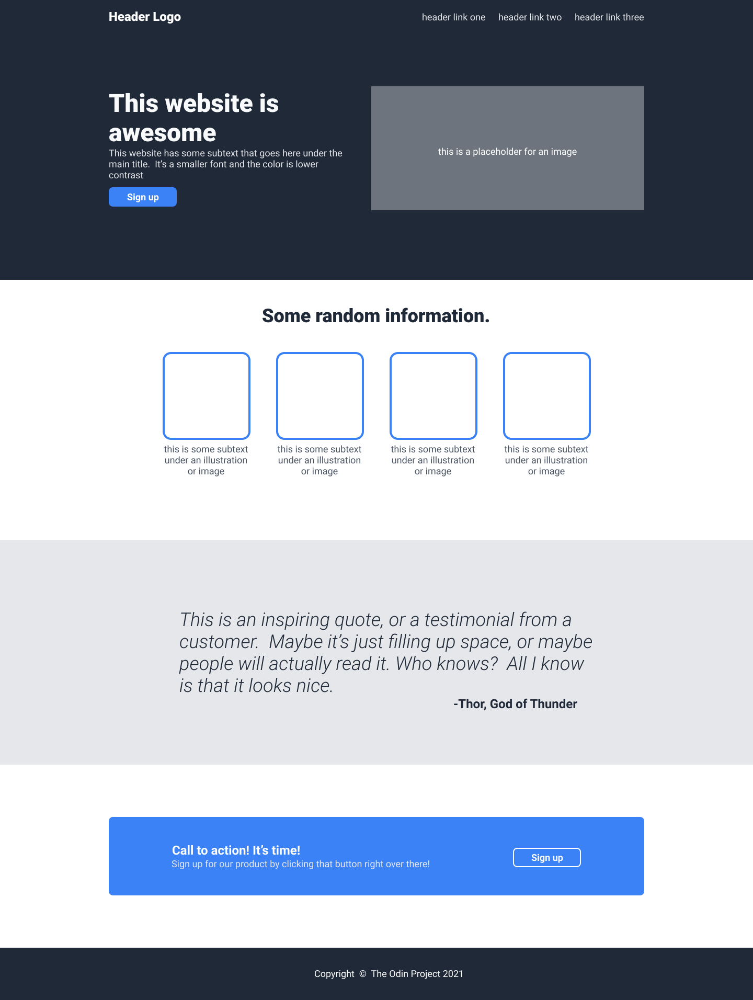

# TOP-Project-Landing-Page
Practical project for [The Odin Project Foundations Course Flexbox](https://www.theodinproject.com/paths/foundations/courses/foundations#flexbox)

For a full description, see the project page: [The Odin Project: Foundations Landing Page](https://www.theodinproject.com/lessons/foundations-landing-page)

## Introduction
> For this project you’ll be creating an entire web page from a design we’ll provide for you. If you’ve been following along you should have the skills you need to accomplish this, but it may not be easy!

> The design we’re providing you is an image of the complete website, along with details about the fonts and colors in the assignment section below.

## Assignment
- Font: Roboto (you will need to download and install this font if you don’t already have it)
- Dark background color (header, hero section and footer): #1F2937
- Logo text:
    - Font size: 24px
    - Color: #F9FAF8
- Hero section main text (“This website is awesome”):
    - Font size: 48px
    - Color: #F9FAF8
    - Weight: 900
- Hero secondary text (“This website has some subtext…”) and header links:
    - Font size: 18px
    - Color: #E5E7EB
- Button and “Call to action” background color: #3882F6
- Information heading:
    - Font size: 36px
    - Color: #1F2937
    - Weight: 900
- Quote:
    - Background color: #E5E7EB
    - Font size: 36px
    - Color: #1F2937
    - Weight: 300
    - Font style: italic

> You do not need to make this project responsive. That means you don’t have to adjust your design for different screen sizes, zoom levels, or mobile devices. For now, just focus on making it look good on a regular computer screen. You’ll learn how to handle different screen sizes later.

## Desired outcome

